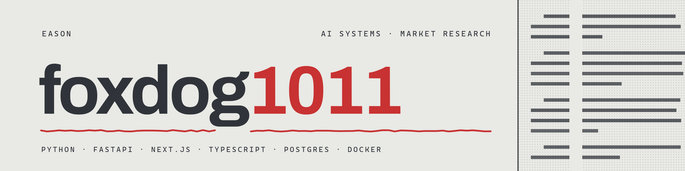

# Hi, I'm Eason Lin

I build and operate production data and AI systems. My recent work focuses on financial research, learning products, and the engineering needed to keep them reliable.

## Featured projects

### Stock Ledger
An independently built Taiwan-equity research and decision system.

- Connects dated market evidence, private portfolio context, and a public research-to-media pipeline.
- I diagnosed a Docker networking exposure, added a regression guard, and made missing financial data visible instead of treating it as zero.
- I downgraded a buy signal after reviewing 325 resolved calls: its 46% hit rate did not justify its original role.

[Engineering case study](https://foxdog1011.github.io/stock-ledger-showcase/) · [Read-only guest view](https://covenest.systems/auth/guest) · [Showcase source](https://github.com/foxdog1011/stock-ledger-showcase)

### Lumi
An IELTS learning platform connecting assessment to practice, revision, and transfer checks.

- Built separate Writing and Speaking assessment workflows and persistent learning targets.
- Rebuilt Writing evaluation around a fixed set of official examiner-scored samples and measured run-to-run variance before accepting changes.
- Kept model-generated feedback separate from database-controlled mastery transitions.

[Engineering case study](https://github.com/foxdog1011/ielts-ai-platform-demo) · [Live product](https://lumi.covenest.systems/)

## Technologies

Python · TypeScript · FastAPI · Next.js · PostgreSQL · Supabase · Redis · Docker · Linux · GitHub Actions · OpenAI / Anthropic APIs

## Contact

[LinkedIn](https://www.linkedin.com/in/easonlin10) · [Email](mailto:eason4522@gmail.com)
